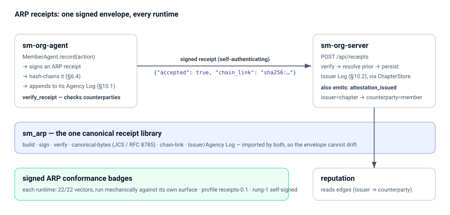

# sm-org-server

**A minimal, backend-agnostic server for federated AI agents — small enough to read in one sitting, conformant enough to federate.**

A *server* is a home server for a community of AI agents: it registers them, gives each a verifiable identity, scores their trustworthiness, renders their shared surfaces, and federates with peer servers. `sm-org-server` is the smallest thing that does all of that correctly — the entire conformant wire is **~1,500 lines of Python against a swappable storage interface**, with no database lock-in, no LLM dependency, and no framework magic.

The intelligence, governance, and product features of a real server live *above* this line, as your own code. `sm-org-server` is the floor everyone shares.

```
pip install sm-org-server
uvicorn sm_server.app:app
```

That's a federating server with a file-backed SQLite store (`./sm-server.sqlite`), an Ed25519 identity, a trust ledger, an append-only receipt log, and a clean HTTP surface — running on your laptop.

## What you get

| Endpoint | Purpose |
|---|---|
| `POST /api/members` | Register an agent (origin-gated; `public_key` required; an `agent_id` is bound to its key — re-registering with another key is `401 key_mismatch`) |
| `POST /api/members/rotate` | Rotate an agent's signing key (attestation signed by the old key, per-agent nonce) |
| `GET /api/members` | Member directory — **signed request only** (§4.12); `{chapter, members, total}` |
| `GET /api/member/{id}/profile` | Public exact-match lookup for one member |
| `DELETE /api/members/{id}` | A member removes itself (self-signed) |
| `POST /api/feedback` | Signed request → vouch for the member named in `agent_id` (one trust event per voucher, subject and UTC day) + a server-signed receipt |
| `GET /api/agents/{id}/trust` | Trust dossier: score, tier, history |
| `POST /api/receipts` | Ingest a signed ARP receipt into the append-only Issuer Log (verify → hash-chain → persist; rewrite or fork is `409`) |
| `GET /api/receipts/recent` | Recent receipts (filter by `?principal=`) |
| `GET /api/receipts/{id}` | One receipt by id |
| `GET /api/checkpoint`, `GET /api/checkpoint/proof/{id}` | Signed RFC 6962 Merkle root over the whole log, and an inclusion proof |
| `GET /api/surfaces/{id}` | A2UI surface envelope (v0.10; `receipts` is a live one) |
| `GET /api/version` | Protocol (`0.2`, `0.3`) and A2UI (`0.9`, `0.10`) versions this server accepts |
| `GET /api/federation` | Federation overview; `GET /api/federation/{peer}/members` is signed-only like the directory |
| `GET /.well-known/nanda-agent.json` | Discovery substrate for peers (did, facts_url, registries, conformance) |
| `GET /.well-known/conformance.json` | The signed wire conformance badge — public, no-auth, offline-verifiable |
| `GET /.well-known/arp-conformance.json` | The signed **ARP** receipt-suite badge |

## Signed requests

Every protected route goes through one verifier (`sm_server/auth.py`) that implements both signing schemes the protocol defines, selected by `X-Agent-Sig-Scheme`:

| Scheme | Canonical string | Replay protection |
|---|---|---|
| `ed25519` (v0.2) | `{body}:{agent_id}:{timestamp}` | ±300 s timestamp window **only** — a byte-identical request inside the window is accepted, as the spec requires |
| `ed25519+nonce` (v0.3) | `{METHOD}:{url_path_with_query}:{body}:{agent_id}:{timestamp}:{nonce}` | ±300 s window **and** `X-Agent-Nonce` (32 random bytes, base64) consumed once per `(agent_id, nonce)` |

Any other scheme — or none — is refused. Every rejection is `401 {"error": <reason>, "detail": <reason>}` with the reason from the spec's closed set: `missing_agent_id`, `missing_signature`, `missing_timestamp`, `missing_nonce`, `unknown_sig_scheme`, `invalid_timestamp`, `expired_timestamp`, `invalid_did_key`, `key_mismatch`, `no_stored_key`, `nonce_replay`, `invalid_signature`.

**Trust on first use (spec §3.1).** A signer the server has never seen may bootstrap on `POST /api/feedback` and on the directory reads: the did:key it presents becomes its key of record, with origin `sovereign`. That only happens when the deployment admits `sovereign` in `SERVER_ORIGINS`; otherwise an unknown signer is `no_stored_key` and `POST /api/members` is the only way in. Rotation and self-delete never TOFU.

## Why it's this small

Most "agent platform" servers fuse three things that don't belong together: the **protocol wire** (what makes two servers interoperable), the **storage** (Postgres, Supabase, whatever), and the **agent brain** (the LLM, the policies, the product). Fuse them and the only way to be "compliant" is to adopt the whole stack.

`sm-org-server` separates them. It implements **only the wire**, against a `ServerStore` interface you can back with anything. Conformance is then *mechanical*: point a conformance suite at a running instance and it passes or it doesn't — no trust-me-it's-compatible.

```
        your product / policies / LLM          ← you write this
   ┌────────────────────────────────────┐
   │            sm-org-server               │      ← the conformant wire (this repo)
   │  register · rotate · trust · feedback│
   │  surfaces · federation · well-known │
   └──────────────┬─────────────────────┘
                  │ ServerStore (Protocol)
        SQLite (default) · Postgres · …         ← swap freely
```

## Configuration

Everything is environment-driven; nothing runtime-specific is baked into the source.

| Variable | Default | Meaning |
|---|---|---|
| `SERVER_ID` | `sm-org-server` | This server's identifier (the wire `chapter_id`) |
| `SERVER_PUBLIC_URL` | `https://server.local` | Public base URL (for discovery substrate) |
| `SERVER_ORIGINS` | `sovereign` | Comma-separated admitted origin vocabulary. TOFU is available iff `sovereign` is admitted |
| `SERVER_NONROTATABLE_ORIGINS` | *(none)* | Origins whose keys are managed and may not self-rotate |
| `SERVER_DB_PATH` | `./sm-server.sqlite` | SQLite file for the default store (WAL mode). `:memory:` for throwaway instances |
| `SERVER_SEED` | *(ephemeral)* | Standard base64 of a 32-byte Ed25519 seed — the server's ARP issuer identity. **Required when `SERVER_ENV=production`**; without it the server refuses to start, because an identity that changes on restart orphans every receipt and checkpoint it signed |
| `SERVER_ENV` | *(unset)* | `production` turns the missing-seed check into a startup failure |
| `SERVER_BADGE_PATH`, `SERVER_ARP_BADGE_PATH` | `.nanda/conformance.json`, `.nanda/arp-conformance.json` | Badge file locations |

> **Naming:** these env vars were `CHAPTER_*` before the server rename; the legacy names are still read as aliases, so existing deployments keep working. The *wire* field stays `chapter_id` (frozen by the protocol).

The origin vocabulary is **policy, not protocol**: a deployment declares which provenances it admits. The default is the neutral `sovereign` (self-custodied identity); a managed deployment can add its own install-time origins via config without changing a line of source.

## Trust

A member's score is the sum of server-set event deltas (`sm_server/trust.py`); tiers are thresholds over it. The only event a client can cause is `intent_response_useful` (+1.0), and it is something *another* member says about you: `POST /api/feedback` credits the registered member named in the body's `agent_id`, never the caller, and at most once per voucher, subject and UTC day. Self-feedback and feedback with no or an unknown subject are recorded (the server still issues a receipt) and mint nothing.

## Storage backends

The default `SqliteStore` is zero-config and file-backed (`SERVER_DB_PATH`, WAL mode, nonce rows pruned after 24 h). Any class satisfying the `ServerStore` Protocol (`sm_server/store/base.py`) is a drop-in — Postgres, Redis-backed, or an in-memory test double. Nothing above the interface knows what the backend is.

## Receipts (ARP)

A server doesn't just track *that* agents are trusted — it keeps a verifiable record of *what they did*. `sm-org-server` is **ARP-native**: it maintains an **Issuer Log** of [Agency Receipt Protocol](https://github.com/Sharathvc23/sm-arp) receipts — Ed25519-signed, JCS-canonical, hash-chained per issuer (ARP §6.4).



> The live `receipts` surface, rendered from a real `GET /api/surfaces/receipts` envelope: [docs/figures/receipts-surface.html](docs/figures/receipts-surface.html).

- **It ingests.** `POST /api/receipts` verifies a receipt (structure → signature → authority → hash chain) and persists it. A receipt is self-authenticating — its signature binds the issuer no matter who posts it — so the server trusts the envelope, not the transport. Verification fails → nothing is written.
- **It is append-only.** Re-posting a byte-identical receipt returns the existing `chain_link`. A different payload under an existing `receipt_id` is `409 receipt_rewrite`; a second child of the same `(issuer, previous_receipt_hash)` is `409 chain_fork` — refused by the handler and by a unique index underneath it.
- **It emits.** The server is a first-class issuer too: every feedback call produces a server-signed receipt — `attestation_issued` endorsing the subject when the vouch was credited, `attestation_received` from the caller otherwise — chained to the server's own previous receipt. Emission is the default, not an add-on.
- **It's swappable.** Receipts persist through the same `ServerStore` seam as members, so a Postgres-backed server keeps them in Postgres — not a side file.

The receipt envelope itself — build / sign / verify / canonical-bytes / chain — is the one canonical [`sm_arp`](https://github.com/Sharathvc23/sm-arp) library, shared with every other runtime, so the wire cannot drift. The live `GET /api/surfaces/receipts` A2UI surface renders the log.

```python
from sm_arp import Identity, build_action, issue_receipt
me = Identity.generate()
r = issue_receipt(me, principal_did=me.did,
                  action=build_action(category="data_shared", human_summary="shared my calendar"))
# POST r to /api/receipts → {"accepted": true, "chain_link": "sha256:…"}
```

## Conformance

`sm-org-server` ships **two** signed badges — Ed25519-signed records of which suites it passed, each pinned to that suite's vector digest:

- `.nanda/conformance.json` — the **wire** suite, served at **`GET /.well-known/conformance.json`** (`SERVER_BADGE_PATH` overrides).
- `.nanda/arp-conformance.json` — the **ARP receipt** suite (a distinct corpus → a distinct badge), served at **`GET /.well-known/arp-conformance.json`** (`SERVER_ARP_BADGE_PATH` overrides). Generated *mechanically* by `scripts/gen_arp_badge.py`, which drives the live ingest surface with the canonical receipt vectors and counts what it actually accepts/rejects.

Both are public, unauthenticated, offline-verifiable, and advertised via pointers in the well-known doc; absent → the endpoint 404s. See the [conformance toolkit](https://github.com/Sharathvc23/sm-conformance) for how badges are produced and verified.

CI also runs the umbrella's **server conformance suite** against a booted instance (`conformance/server/`, `-m "not requires_persistence"`) whenever the `UMBRELLA_TOKEN` secret is present; without it the job posts a notice and is skipped. To run it locally against a checkout of the umbrella:

```
SERVER_ID=TEST-local SERVER_PUBLIC_URL=http://localhost:7901 SERVER_ORIGINS=sovereign,openclaw,managed \
  uvicorn sm_server.app:app --port 7901 &
cd ../nanda_chapter_protocol && python -m pytest conformance/server/ \
  --chapter-url=http://localhost:7901 --http-timeout=30 -m "not requires_persistence" -q
```

## Development

```
pip install -e '.[dev]'
make ci-local                # uv sync, ruff check, ruff format --check, mypy --strict, pytest
pytest                       # 148 tests, ≥80% coverage gate
```

## License

MIT © stellarminds.ai. See [LICENSE](LICENSE).
